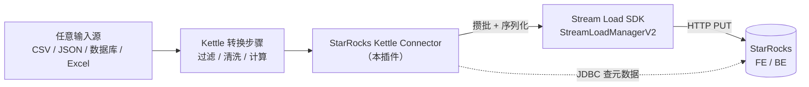
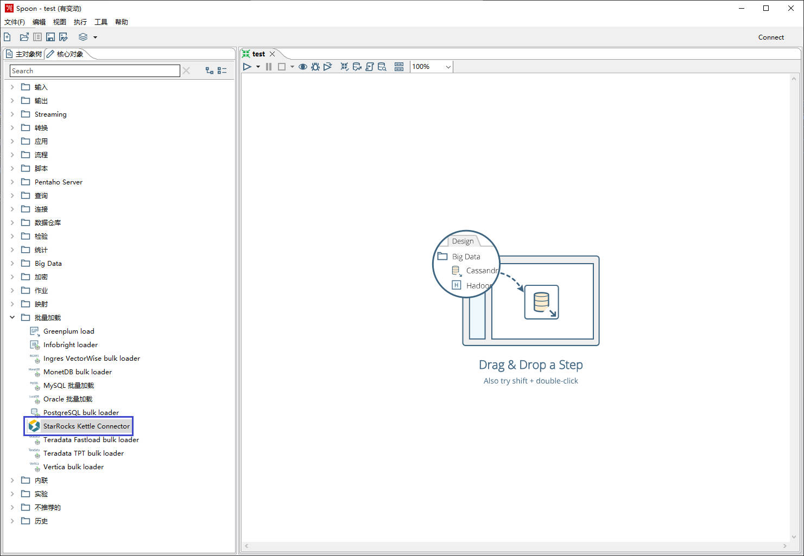
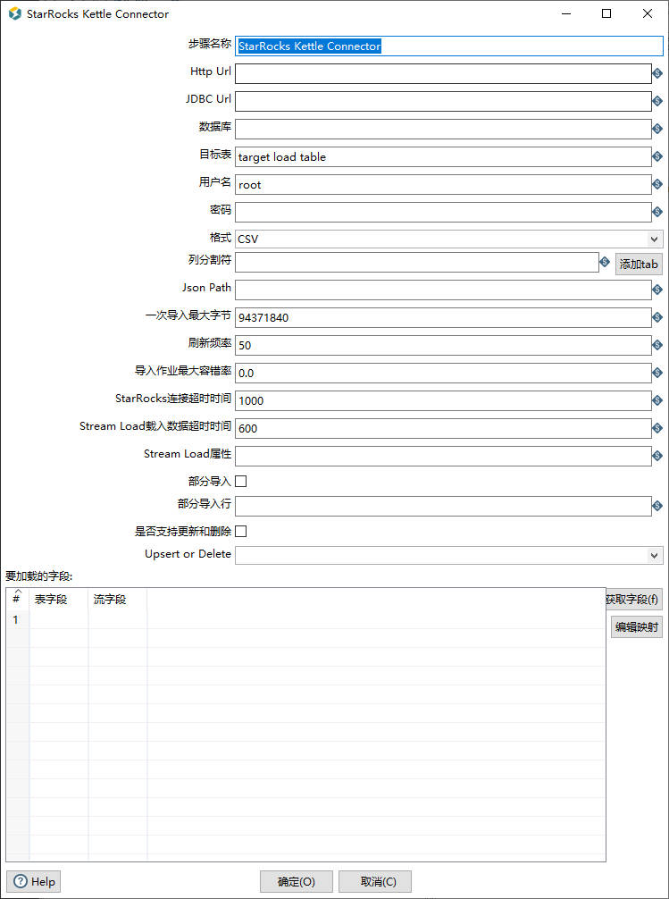

# StarRocks Kettle Connector

[](./kettle-src/LICENSE.txt)
[]()
[]()
[]()

> 在 Pentaho Data Integration（Kettle / Spoon）里以**可视化拖拽**的方式把数据写入 StarRocks，
> 底层走 Stream Load 协议，无需写一行代码。

本仓库是 [StarRocks/starrocks-connector-for-kettle](https://github.com/StarRocks/starrocks-connector-for-kettle)
的**可离线构建版本**。上游项目声明的 Pentaho Maven 仓库已经下线、新仓库又需要登录鉴权，
导致按官方 README 的步骤在任何一台干净机器上都**必然编译失败**。本仓库把这套构建链路重做成了
「从本机已安装的 Kettle 里取 jar → 灌入 Maven 本地仓库 → 编译打包」，并附带一套一键脚本。

---

## 目录

- [为什么需要这个项目](#为什么需要这个项目)
- [功能特性](#功能特性)
- [仓库结构](#仓库结构)
- [环境要求](#环境要求)
- [快速开始：三步编译出插件包](#快速开始三步编译出插件包)
- [安装到 Kettle](#安装到-kettle)
- [步骤参数说明](#步骤参数说明)
- [数据类型映射](#数据类型映射)
- [使用示例](#使用示例)
- [常见问题](#常见问题)
- [已知限制](#已知限制)
- [已知问题（继承自上游，尚未修复）](#已知问题继承自上游尚未修复)
- [与上游版本的差异](#与上游版本的差异)
- [License 与致谢](#license-与致谢)

---

## 为什么需要这个项目

StarRocks 官方已经提供了 DataX、Flink、Spark 三种导入方式，但它们都需要写代码或敲命令行，
对非技术同学不友好。Kettle 是 ETL 领域普及度很高的可视化工具，把它接上 StarRocks 后：

- **零代码**：拖一个步骤、填几个参数、点「启动」就开始导数据；
- **能复用 Kettle 的组件库**：Excel / JSON / REST / 数据库 / 脚本 等任意输入源都能作为上游；
- **享受 StarRocks 的写入性能**：底层是 Stream Load 攒批异步写入，不是逐条 INSERT。

而上游项目的**构建**这一环是断的。具体断在四处（均已实测复现）：

| # | 问题 | 现象 |
|---|------|------|
| 1 | 父 POM 仓库 `repo.orl.eng.hitachivantara.com` 已下线 | `不知道这样的主机` / `NXDOMAIN` |
| 2 | 官方迁移后的 `repo.pentaho.com` 强制 Basic 鉴权 | `status code: 401` |
| 3 | `starrocks-stream-load-sdk:1.0-SNAPSHOT` 从未发布 | 中央仓库只有 `1.0` |
| 4 | `org.eclipse.swt:...:4.6` 不在中央仓库 | 只有 `4.3` |

**第 1、2 条意味着：Pentaho 的构件在公网上已经不存在任何匿名可读的来源。**
Maven 中央仓库、阿里云 / 华为云 / 腾讯云镜像、JBoss / Atlassian / Mulesoft / RedHat 聚合仓库
全部没有 `pentaho-kettle` 这个 groupId，SourceForge 上的 PDI 发行包也已下架。

所以本仓库的唯一可行路径是：**从你自己机器上已经装好的 Kettle 里，把 `lib` 目录下的 jar
按 Maven 仓库布局灌进本地仓库**，让项目从本地仓库取依赖。`kettle-offline/` 下的工具就是干这个的。

---

## 功能特性

| 能力 | 说明 |
|---|---|
| **Stream Load 写入** | 通过 StarRocks Stream Load SDK 攒批异步写入，`cacheMaxBytes` / `scanningFrequency` 可调 |
| **CSV / JSON 两种格式** | 上游任意数据格式都能进来，出口只支持这两种（Stream Load 的限制） |
| **字段映射** | 「表字段 ↔ 流字段」一一对应，支持在 UI 里手工调整映射顺序 |
| **部分列更新** | 主键模型表（StarRocks ≥ 2.2）只更新指定列，勾选「部分导入」并填列名即可 |
| **UPSERT / DELETE** | 勾选「是否支持更新和删除」后选择操作类型，通过 `__op` 列下发给 StarRocks |
| **自定义 Stream Load 属性** | `key1:value1;key2:value2` 形式透传任意 Stream Load header |
| **元数据自动读取** | 通过 JDBC 查 `information_schema` 拿表结构，无需手工填字段类型 |
| **中英文界面** | `messages_zh_CN` / `messages_en_US` 两套资源 |

步骤在 Spoon 里的位置：**核心对象 → 批量加载（Bulk）→ StarRocks Kettle Connector**。

数据流是这样的：



---

## 仓库结构

```
starrocks-connect-kettle/
├── kettle-src/                    # 插件源码（Maven 多模块）
│   ├── pom.xml                    # 根 POM（已改造，见下文）
│   ├── impl/                      # 核心实现：Step / Meta / Data / Serializer
│   │   └── src/main/java/com/starrocks/connector/kettle/steps/starrockskettleconnector/
│   │       ├── StarRocksKettleConnector.java       # 步骤执行逻辑（processRow / transform）
│   │       ├── StarRocksKettleConnectorMeta.java   # 参数定义与校验（约 1000 行）
│   │       ├── StarRocksKettleConnectorData.java   # 运行时数据
│   │       └── starrocks/                          # SDK 适配层：连接、序列化、元数据查询
│   ├── ui/                        # Spoon 配置对话框（SWT）
│   ├── assemblies/plugin/         # 打包：输出 zip 插件包
│   ├── image/                     # 文档截图
│   └── README.md                  # 上游原始中文文档（功能/示例最全）
│
├── kettle-offline/                # 【本仓库新增】离线构建工具链
│   ├── PdiOfflineSetup.java       # 单文件工具：扫 lib/*.jar → 灌入 Maven 本地仓库
│   ├── 1-setup-repo.sh            # 第 1 步封装
│   ├── 2-build.sh                 # 第 2 步封装
│   ├── 方案B-离线编译流程.md       # 完整原理与排错手册
│   └── 公司电脑操作步骤.md         # 换机执行的清单
│
├── tools/apache-maven-3.9.9/      # 随仓库附带的 Maven（省去自己装）
├── maven-settings-pentaho-template.xml  # 若拿到 Pentaho 账号，走在线方案时的 settings 模板
└── StarRocks-Kettle-Connector-编译分析与构建指南.md  # 编译失败的完整根因分析
```

---

## 环境要求

| 项 | 要求 | 说明 |
|---|---|---|
| **JDK** | 11 或 17 | 灌仓库工具用「单文件源码运行」（JEP 330），**JDK 8 跑不了**；且用到 `String.isBlank()` |
| **Maven** | 3.6+ | 仓库自带 3.9.9，也可用你自己的 |
| **已安装的 Kettle** | 8.3 / 9.5 任一 | 唯一作用：提供 `data-integration/lib` 下的 jar |
| **Shell** | Git Bash（Windows） | 脚本含 Bash 语法，**不要在 cmd 里敲 `bash`**（会命中 WSL 的 bash） |
| **网络** | 能访问 Maven 中央仓库或镜像 | 首次构建要下插件与公开依赖；离线拿不到的只有 Pentaho 那几个 jar |

> **Kettle 版本必须和 `kettle-src/pom.xml` 里的 `<pdi.version>` 一致。**
> 本仓库默认对齐 **`8.3.0.0-371`**。如果你的 Kettle 是别的版本，
> 改 `pom.xml` 里 `<pdi.version>` 与 `<parent><version>` 两处，并把版本号传给脚本。

---

## 快速开始：三步编译出插件包

### 第 1 步：确认 JDK

```bash
export JDK_HOME="C:/Program Files/Java/jdk-11"    # 改成你的 JDK 11/17 路径
"$JDK_HOME/bin/java" -version                      # 必须显示 11.x 或 17.x
```

> ⚠️ 如果机器上 `JAVA_HOME` 指向 JDK 8，**必须显式设置 `JDK_HOME` 覆盖它**，
> 否则 Maven 会跑在 JDK 8 上，编译直接失败。

### 第 2 步：把 Kettle 的 lib 灌进 Maven 本地仓库

```bash
cd kettle-offline
bash 1-setup-repo.sh "D:/pdi/data-integration" 8.3.0.0-371
```

- 参数 1 指向 `data-integration` 目录（其下有 `lib/`），也可以直接指向 `lib` 目录本身；
- 参数 2 是 Kettle 版本，省略则默认 `9.5.0.0-240`；
- **路径一定要加引号**。不加引号时 Bash 会把 `\s`、`\p` 当转义吃掉，
  `D:\starrocks\pdi-lib` 会变成 `D:starrockspdi-lib`。

这一步做了什么：

1. 扫描 `lib/*.jar`（**拷整个 lib 目录，不要挑**，`kettle-core` 的传递依赖有一大批）；
2. 从每个 jar 内部的 `META-INF/maven/*/*/pom.properties` 读出**真实坐标**（不靠猜文件名），
   按 Maven 仓库目录规范写入本地仓库；
3. 生成聚合依赖 `pentaho-kettle:pdi-kettle-all`，把 lib 里所有 jar 一次性列进去；
4. 生成**占位父 POM** `org.pentaho.di.plugins:pdi-plugins`，替代已下线的官方父 POM，
   并按 PDI 版本锁定字节码目标（PDI 8.x → Java 8，PDI 9.x → Java 11）；
5. 自动跳过 `-tests.jar` / `-sources.jar` / `-javadoc.jar`；幂等，重复执行只会覆盖。

本地仓库路径会**自动探测**（企业环境常被 `settings.xml` 改到别处）。想手工指定就设 `M2_REPO`：

```bash
M2_REPO="D:/Maven/repo" bash 1-setup-repo.sh "D:/pdi/data-integration" 8.3.0.0-371
```

### 第 3 步：编译打包

```bash
bash 2-build.sh
```

产物：

```
kettle-src/assemblies/plugin/target/starrocks-kettle-connector-plugins-1.0-SNAPSHOT.zip
```

脚本内部等价于：

```bash
mvn -B clean
mvn -B package -Dmaven.test.skip=true
```

两个细节值得说明：

- **`-Dmaven.test.skip=true` 必须加**：测试代码依赖 `kettle-core` / `kettle-engine` 的
  `tests` 分类器构件，这些只在 Pentaho 私有仓库里，离线拿不到。
- **`clean` 单独跑、不写成 `clean package`**：`mvn clean package` 是逐模块执行的，
  根模块先 clean→package 时（`apache-rat-plugin` 就在这一步），`impl/target`、`ui/target`
  还是上一次的残留，会被许可证审计当成「无许可证头的文件」而报错。
  实在不想管审计，加 `bash 2-build.sh -Drat.skip=true`。

---

## 安装到 Kettle

```bash
# 1. 解压到 Kettle 的 plugins 目录
cd <KETTLE_HOME>/plugins
unzip starrocks-kettle-connector-plugins-1.0-SNAPSHOT.zip
# 得到 starrocks-kettle-connector/ 目录

# 2. 把 MySQL JDBC 驱动放进插件的 lib 目录（必须，见下）
cp mysql-connector-java-8.0.27.jar starrocks-kettle-connector/lib/
```

**为什么必须手动放 JDBC 驱动**：`mysql-connector-java` 是 GPL 许可，本项目（Apache 2.0）
不能直接打包分发它。但插件需要通过 JDBC 连接 StarRocks 读取表元数据，所以得你自己放一份。
下载地址：[MySQL 官网](https://dev.mysql.com/downloads/connector/j/) 或
[Maven 中央仓库](https://repo1.maven.org/maven2/mysql/mysql-connector-java/)。

启动 `Spoon.bat`（Windows）或 `Spoon.sh`（Linux），在 **批量加载** 分类下就能看到
**StarRocks Kettle Connector**。



---

## 步骤参数说明

双击步骤打开配置框：



### 连接类

| 参数 | 必填 | 默认值 | 说明 |
|---|:---:|---|---|
| 步骤名称 | 是 | StarRocks Kettle Connector | 该步骤在转换里的名字 |
| Http Url | 是 | 无 | FE 的 HTTP Server 地址，格式 `<fe_host>:<fe_http_port>`，多个用 `;` 分隔，如 `192.168.1.1:8030;192.168.1.2:8030` |
| JDBC Url | 是 | 无 | `jdbc:mysql://<fe_host>:<fe_query_port>`，**只用于读取表元数据**，填一个地址即可 |
| 数据库 | 是 | 无 | StarRocks 目标库名 |
| 目标表 | 是 | 无 | StarRocks 目标表名 |
| 用户名 | 是 | root | 需具备目标表的写权限，见 [用户权限](https://docs.starrocks.io/zh-cn/latest/administration/User_privilege) |
| 密码 | 否 | 空 | 无密码则留空 |

### 格式类

| 参数 | 必填 | 默认值 | 说明 |
|---|:---:|---|---|
| 格式 | 是 | CSV | `CSV` 或 `JSON` |
| 列分割符 | 否 | `\t` | 仅 CSV。最大 50 字节的 UTF-8 字符串，**与上游文件的分隔符无关**，只需与 StarRocks 侧一致 |
| Json Path | 否 | 无 | 仅 JSON。匹配模式下指定待导入字段名，参见 [导入 JSON 数据时配置列映射](https://docs.starrocks.io/zh-cn/latest/sql-reference/sql-statements/data-manipulation/STREAM%20LOAD#导入-json-数据时配置列映射关系) |

### 攒批与超时类

| 参数 | 必填 | 默认值 | 说明 |
|---|:---:|---|---|
| 一次导入最大字节 | 否 | 94371840（90 MB） | 攒批阈值，达到即触发 Stream Load。范围 [64 MB, 10 GB] |
| 刷新频率 | 否 | 50 | 单位毫秒，多久检查一次是否该刷新，≥ 50 |
| StarRocks 连接超时时间 | 否 | 1000 | 连接 `Http Url` 的超时，范围 [100, 60000] |
| Stream Load 载入数据超时时间 | 否 | 600 | 单位秒 |
| 导入作业最大容错率 | 否 | 0 | 允许被过滤掉的脏数据比例，范围 [0, 1] |
| Stream Load 属性 | 否 | 无 | 透传任意 Stream Load header，格式 `key1:value1;key2:value2` |

### 高级类

| 参数 | 必填 | 默认值 | 说明 |
|---|:---:|---|---|
| 部分导入 | 否 | 否 | 勾选后只更新「部分导入行」里列出的列（主键模型表，StarRocks ≥ 2.2） |
| 部分导入行 | 否 | 无 | 要更新的列名，逗号分隔，如 `col1,col2,col3` |
| 是否支持更新和删除 | 否 | 否 | 勾选后通过 `__op` 列下发操作类型 |
| Upsert or Delete | 否 | 无 | 选 `UPSERT` 或 `DELETE`。**一个步骤只能选一种**，不能在一批数据里混用 |
| 表字段 | 否 | 无 | StarRocks 目标表的列名 |
| 流字段 | 否 | 无 | 上游传过来的列名，类型和长度必须与目标表完全匹配 |

> **映射顺序很重要**：表字段和流字段按位置一一对应。如果对不上，
> **不要改流字段的顺序**，改表字段的顺序去迁就它。

---

## 数据类型映射

| Kettle | StarRocks |
|---|---|
| String | CHAR、VARCHAR、STRING、JSON |
| Date | DATE、DATETIME |
| Boolean | BOOLEAN |
| Integer | TINYINT、SMALLINT、INT、BIGINT |
| Number | DOUBLE、FLOAT |
| BigNumber | LARGEINT、DECIMAL |
| Timestamp | DATETIME、DATE |
| Internet Address | STRING |
| Binary | 暂不支持 |
| serializable | 暂不支持 |

Kettle 侧的类型说明：**Integer** 内部一律按 `Long` 处理；**Number** 是双精度浮点（≥15 位精度）；
**BigNumber** 是任意精度（对应 DECIMAL / LARGEINT）；**Date** 存的是毫秒时间戳。

---

## 使用示例

完整的分步截图教程在 [`kettle-src/README.md`](./kettle-src/README.md)（上游原始文档），
这里给出最小可跑的骨架。

### 场景：CSV 文件 → StarRocks

**1. 准备数据**

```csv
1,Lily,23
2,Rose,23
3,Alice,24
```

**2. 建表**

```sql
CREATE DATABASE IF NOT EXISTS kettle_test;
USE kettle_test;
CREATE TABLE `student` (
    `id`    INT          NOT NULL COMMENT "用户 ID",
    `name`  VARCHAR(255) NULL     COMMENT "用户姓名",
    `score` INT          NOT NULL COMMENT "用户得分"
) ENGINE=OLAP
PRIMARY KEY(`id`)
DISTRIBUTED BY HASH(`id`);
```

**3. 搭转换**

```
CSV 文件输入  ──▶  StarRocks Kettle Connector
```

- CSV 文件输入：填文件路径，列分割符改成 `,`，无表头则取消「列头行」，点「获取字段」后校正类型；
- StarRocks 步骤：填 Http Url / JDBC Url / 库 / 表 / 用户名，
  点「获取字段」拉取目标表结构，核对「表字段 ↔ 流字段」映射。

**4. 启动并验证**

```sql
SELECT * FROM student;
```

### 场景：UPSERT / DELETE

```csv
# 待写入
1,Lily,90      -- 已存在，更新 score
5,Jeson,0      -- 不存在，插入
```

勾选「是否支持更新和删除」→ `Upsert or Delete` 选 `UPSERT`，其余同 CSV 场景。

执行 `DELETE` 时同理，只是把操作选成 `DELETE`，文件里放待删除记录的主键。

> **限制**：上游传来的数据里没有「这一行该 INSERT 还是该 DELETE」的标识，
> 所以一个步骤只能用一种操作。要混合处理，用 Kettle 的「复制多线程」把流拆成两条，
> 分别过滤后各接一个步骤。

### 场景：部分列更新

数据文件只包含 `id` 和 `name` 两列时，勾选「部分导入」，
在「部分导入行」填 `id,name`，即可只更新这两列，`score` 保持原值。

---

## 常见问题

| 报错 / 现象 | 原因 | 处理 |
|---|---|---|
| `不知道这样的主机` / `Unknown host` | 仓库域名写错或已下线 | 本仓库已移除该仓库声明；若你恢复了在线方案，改用 `repo.pentaho.com` |
| `status code: 401` | 凭据没配，或 `<server><id>` 与 `<repository><id>` 不逐字相同 | 见 `maven-settings-pentaho-template.xml` |
| `Downloading from central` 然后 404 | `mirrorOf` 写成 `*` 把 Pentaho 仓库也劫持到镜像了 | `mirrorOf` 只写 `central` |
| `Non-resolvable parent POM ... pdi-plugins` | 占位父 POM 没生成或版本不符 | 检查 `<本地仓库>/org/pentaho/di/plugins/pdi-plugins/` 目录名是否与 `<parent><version>` 完全一致 |
| `Could not find artifact pentaho-kettle:pdi-kettle-all` | pom 的 `<pdi.version>` 与灌入的版本不一致 | 两处都改成实际 Kettle 版本后重跑第 2 步 |
| `invalid flag: --release` | Maven 实际跑在 JDK 8 上 | `export JDK_HOME=...` 指向 JDK 11/17 |
| `程序包 org.pentaho.di.xxx 不存在` | 有 jar 没进本地仓库 | 确认 `lib` 拷全（正常 100+ 个 jar）；个别类在 `plugins/` 下时加 `--with-plugins` 重跑 |
| `找不到符号 org.junit...` | 忘了跳过测试 | 加 `-Dmaven.test.skip=true` |
| `Too many files with unapproved license: N` | 不是编译错误，是许可证审计扫到了构建残留 | 先 `mvn clean` 再 `package`；或 `-Drat.skip=true` |
| `UnsupportedClassVersionError` | 字节码版本高于运行 Kettle 的 JVM | 占位父 POM 的 `maven.compiler.release` 别删，按 PDI 版本自动取 8 或 11 |
| `找不到 java: .../bin/java` | 在 **cmd** 里敲了 `bash`，命中了 WSL 的 bash | 一律用 **Git Bash**（提示符 `MINGW64`） |
| Spoon 里步骤名显示成原始 key | 已知 i18n 包路径 bug，见下节 | 不影响功能 |

**`-o`（离线模式）什么时候能用？** 只有在插件和依赖**全部已缓存**之后。
首次构建加 `-o` 必然失败（连 `maven-dependency-plugin` 自身都加载不了），
报 `Cannot access xxx in offline mode` —— 这跟项目无关，去掉 `-o` 重跑即可。

**导入出错想看详细日志？** 控制台只输出摘要，完整日志在
`<KETTLE_HOME>/logs/pdi.log`，含 Kettle 运行信息和 StarRocks Stream Load 的日志（默认 DEBUG 级）。
改级别：关掉 Kettle → 编辑 `plugins/starrocks-kettle-connector/log4j.properties` → 重启。

---

## 已知限制

- **不支持 `at-least-once` / `exactly-once`**：Kettle 本身没有数据回滚和异常重试机制，
  导入出错会直接停止任务。
- **不支持列级计算**：需要在 Kettle 里另加步骤做过滤和转换。
- **不支持 `HLL` 和 `BITMAP`**：这两种高级数据结构暂无法导入。
- **出口格式只有 CSV 和 JSON**：这是 Stream Load 的限制，与上游输入格式无关。
- **`Binary` 类型不支持**。
- **一个步骤只能用一种操作**（UPSERT 或 DELETE），不能逐行区分。

## 已知问题（继承自上游，尚未修复）

这些是上游代码里真实存在的缺陷，编译能过但运行时会出错。本仓库**未修改源码**，
仅改造了构建链路，列出以便排查时少走弯路：

| # | 位置 | 问题 | 后果 |
|---|---|---|---|
| 1 | `StarRocksKettleConnector.transform()` | 取值写成 `r[i]`，应为 `r[data.keynrs[i]]` | 字段映射顺序与上游不一致时**数据串列**（最严重） |
| 2 | `StarRocksKettleConnector.getProperties()` | `property.split(":")[0]` 取了两次，value 应为 `[1]` | 自定义 Stream Load 属性的值全部丢失 |
| 3 | `StarRocksKettleConnectorMeta.check()` | 类型映射检查在 `prev != null` 判断之外，且未判空 | 步骤无上游输入时抛 NPE，被外层吞掉后误报成「数据库错误」 |
| 4 | 同上 | `if (format == "CSV")` 用 `==` 比较字符串 | 恒为 false，分隔符 / JsonPaths 的校验分支永不执行 |
| 5 | `isCorrectTypeMapping()` | `switch` 各 case 无 `break` | 类型不匹配时连打多条日志，语义混乱 |
| 6 | `readData()` | `column_separator` 为空时默认 `"\r"`，而 `setDefault()` 是 `"\t"` | 加载老转换文件时默认分隔符不一致 |
| 7 | `@Step` 注解的 `i18nPackageName` | 指向 `org.pentaho.di.trans.steps.starrockskettleconnector`，实际资源在 `com.starrocks...` | Spoon 里步骤名显示为原始 key |
| 8 | `StarRocksKettleConnectorDialog.generateMappings()` | `targetFields` 只在 `if` 分支赋值 | 第二次点「编辑映射」时目标字段列表为空 |
| 9 | `StarRocksKettleConnectorDialog.getInfo()` | 直接 `Long.valueOf(输入框)` | 输入框留空或非法值时抛 `NumberFormatException` |

> 第 1 条尤其值得注意：**如果你的转换里字段映射顺序和上游输出顺序不一致，导进去的数据会错位。**
> 规避办法是让两边顺序严格一致，或者先把映射顺序对齐再运行。

---

## 与上游版本的差异

本仓库相对 [StarRocks/starrocks-connector-for-kettle](https://github.com/StarRocks/starrocks-connector-for-kettle)
（基线 `d3cecd5`）的改动，**全部集中在构建配置，Java 业务代码一行未动**：

| 文件 | 改动 | 原因 |
|---|---|---|
| `kettle-src/pom.xml` | 移除 `pentaho-public` / `pentaho-public-plugins` 两个仓库声明（原文以注释保留） | 旧地址已下线，新地址 401，留着只会拖慢构建并产生误导性报错 |
| `kettle-src/pom.xml` | `<pdi.version>` 与 `<parent><version>` → `8.3.0.0-371` | 对齐实际使用的 Kettle 版本 |
| `kettle-src/pom.xml` | SWT `4.6` → `4.3` | 中央仓库只有 4.3；`provided` 作用域不影响功能，运行时用 Kettle 自带的 SWT |
| `kettle-src/pom.xml` | SDK `1.0-SNAPSHOT` → `1.0` | `1.0-SNAPSHOT` 从未发布，`1.0` 与源码 API 完全兼容 |
| `kettle-src/pom.xml` | RAT 排除项 `target/**` → `**/target/**` | 原写法只锚定根目录，扫不到子模块的构建残留 |
| `kettle-src/impl/pom.xml` | 新增 `pentaho-kettle:pdi-kettle-all`（`type=pom`, `provided`） | 一次性引入 lib 全部 jar，且不会被打进插件包 |
| `kettle-src/impl/pom.xml` | 移除 `kettle-core` / `kettle-engine` 的 `tests` 分类器依赖 | 离线拿不到，代价是必须跳过测试编译 |
| `kettle-src/ui/pom.xml` | 同上新增 `pdi-kettle-all` | 同上 |
| `kettle-src/assemblies/plugin/pom.xml` | 显式声明 `maven-assembly-plugin` | 原来由父 POM 提供，换成占位父 POM 后必须自己声明，否则不生成 zip |

新增的内容：`kettle-offline/` 工具链、`tools/apache-maven-3.9.9/`、
两份分析文档（`StarRocks-Kettle-Connector-编译分析与构建指南.md`、`kettle-offline/方案B-离线编译流程.md`）、
`maven-settings-pentaho-template.xml`。

**如果你拿到了 Pentaho 仓库账号**，可以走在线方案：把 `pom.xml` 里注释掉的 `<repositories>`
恢复，按 `maven-settings-pentaho-template.xml` 配好凭据，然后直接 `mvn clean package -DskipTests`。

---

## License 与致谢

本项目遵循 [Apache License 2.0](./kettle-src/LICENSE.txt)。

源码来自 StarRocks 官方的
[starrocks-connector-for-kettle](https://github.com/StarRocks/starrocks-connector-for-kettle)，
构建链路的离线改造、分析文档与工具脚本为本仓库新增。

相关文档：

- [StarRocks 官方文档](https://docs.starrocks.io/zh-cn/latest/)
- [Stream Load 语法](https://docs.starrocks.io/zh-cn/latest/sql-reference/sql-statements/data-manipulation/STREAM%20LOAD)
- [Pentaho Data Integration](https://github.com/pentaho/pentaho-kettle)
